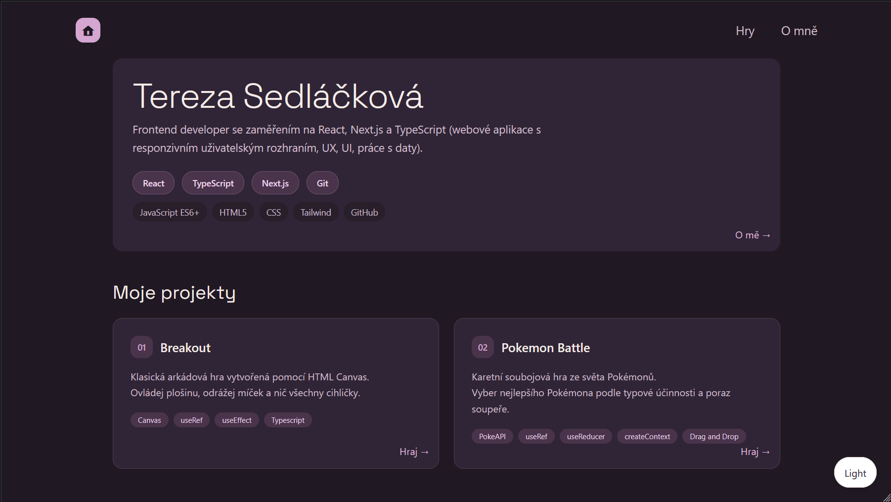
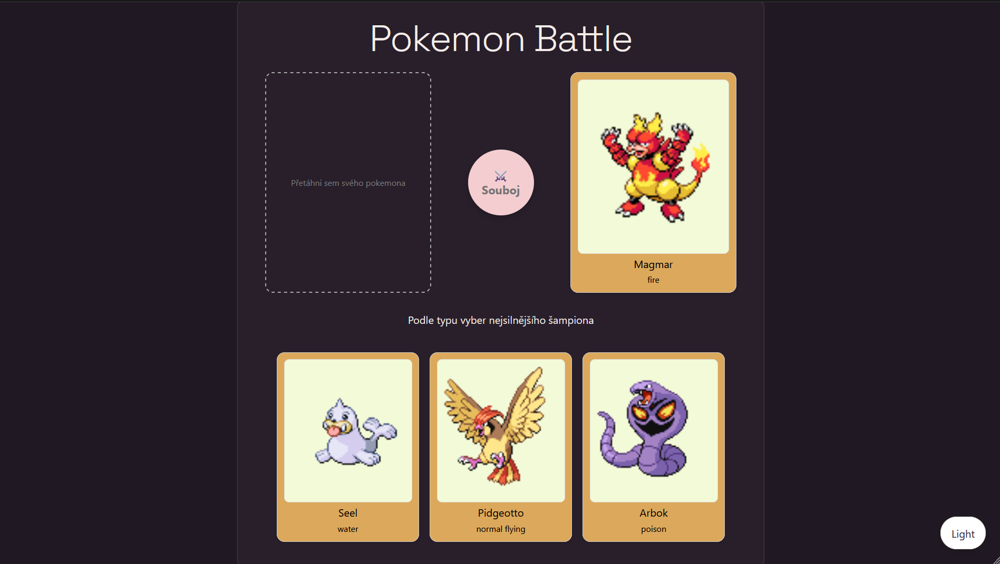
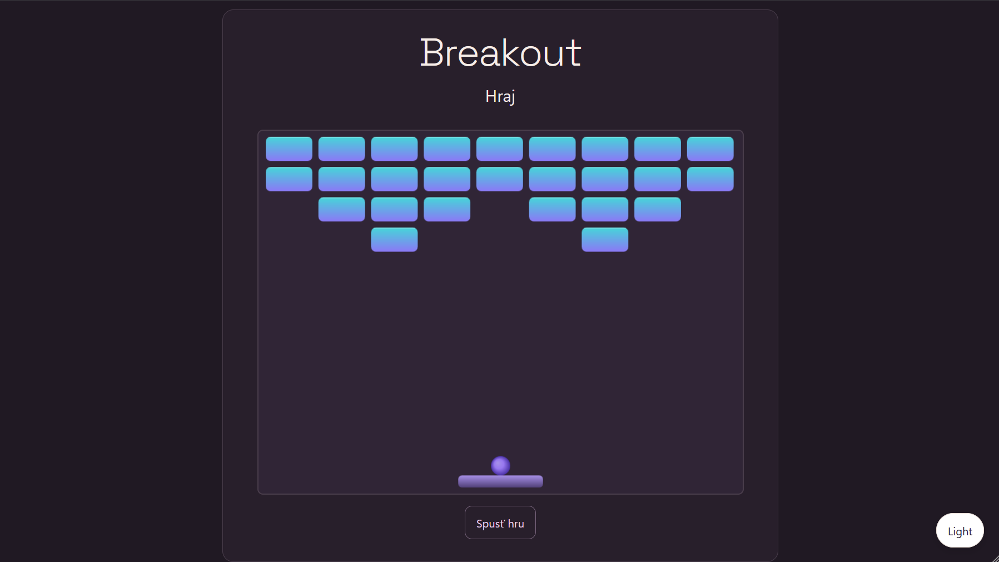

# Portfolio – Tereza Sedláčková

Osobní portfolio vytvořené pomocí Next.js, Reactu a TypeScriptu. Obsahuje úvodní stránku, sekci O mně a dvě interaktivní hry – Pokémon Battle a Breakout.

Cílem projektu je představit mé znalosti a praktické zkušenosti s vývojem webových aplikací.

**[Live demo – Zobrazit portfolio](DOPLŇ_URL)**

---

## Obsah portfolia

### Homepage
Úvodní stránka portfolia, která představuje projekt a slouží jako rozcestník k jeho jednotlivým částem.

### O mně
Sekce věnovaná mně, mým znalostem a zkušenostem.

### Hry
Podrobné informace a odkazy na obě hry.

**Pokémon Battle**

Karetní soubojová hra ze světa Pokémonů, ve které je cílem vybrat Pokémona s typovou výhodou proti soupeři.

**Breakout**

Klasická arkádová hra, ve které hráč ovládá plošinu, odráží míček a snaží se zničit všechny cihly.

---

# Použité technologie

| Technologie | Využití |
|---|---|
| Next.js | Framework, App Router, routing a struktura aplikace |
| React | Tvorba komponent a hooks |
| TypeScript | Typová kontrola |
| Tailwind CSS | Stylování homepage a sekce O mně |
| CSS Modules | Izolované styly jednotlivých her |
| HTML Canvas | Vykreslování hry Breakout |
| PokeAPI | Data o Pokémonech a jejich typech |
| Git & GitHub | Verzování a správa zdrojového kódu |
| Vercel | Nasazení aplikace |

---

## Technické řešení portfolia

<strong>Technologie a stylování</strong>

Webová stránka je vytvořena pomocí **Next.js, Reactu a TypeScriptu**.

Pro tvorbu webu využívám Next.js s App Routerem. Z Next.js používám například komponenty `Image` a `Link`, hook `usePathname` a vestavěné soubory `page`, `layout`, `template`, `not-found` a `error`, které slouží k definování struktury stránek, rozložení a zpracování chyb.

Stylování úvodní stránky a sekce O mně je řešeno pomocí **Tailwind CSS**. Jednotlivé hry využívají **CSS Modules**, díky kterým jsou jejich styly oddělené od zbytku webu.

**TypeScript** zajišťuje typovou kontrolu, například u props předávaných mezi komponentami.

<strong>Přepínání motivu</strong>

Web podporuje světlý a tmavý motiv.

Při načtení stránky se skript v `layout.tsx` pokusí načíst uloženou uživatelskou volbu z `localStorage`. Pokud žádná volba není k dispozici, zjistí systémové nastavení uživatele a podle něj nastaví výchozí motiv.

Komponenta `ThemeButton` pomocí `useState` a `useEffect` pracuje s aktuálním motivem. Umožňuje jeho přepínání a ukládá zvolenou hodnotu do `localStorage`, aby zůstala zachována i při další návštěvě.

<strong>Organizace kódu</strong>

Kvůli přehlednosti a snadnější orientaci v kódu jsou jednotlivé hry umístěny ve vlastních složkách pod složkou `features`.

Každá hra tak má oddělenou strukturu a vlastní komponenty, styly i herní logiku. Do příslušného `page.tsx` se následně importuje hlavní komponenta dané hry.

<strong>Verzování a nasazení</strong>

Pro správu verzí a sledování změn v kódu používám **Git**.

Zdrojový kód je uložen na **GitHubu** a nasazení webu probíhá prostřednictvím **Vercelu**, který je propojený s GitHub repozitářem.

---

# Hry

## Pokémon Battle

Karetní soubojová hra ze světa Pokémonů.

### Pravidla hry

- Vyber Pokémona, který má díky svým typům největší šanci porazit nepřítele.
- Správnou volbou je Pokémon, jehož typ způsobuje nepříteli dvojnásobné poškození alespoň jednomu z jeho typů.
- Na počítači přetáhni vybranou kartu do bitevního pole. Na mobilním zařízení stačí na kartu klepnout.
- Po spuštění souboje se zobrazí výsledek, vítězný Pokémon a vysvětlení, které typy mu zajistily výhodu.

<strong>Technické řešení</strong>

### Technologie

Hra je vytvořena pomocí **Reactu a TypeScriptu**. Styly jsou řešeny pomocí **CSS Modules**.

TypeScript zajišťuje typovou kontrolu dat, props jednotlivých komponent a akcí používaných v reduceru.

### API

Hra využívá veřejné API [PokeAPI](https://pokeapi.co/).

První asynchronní funkce načítá Pokémony první generace. Získává jejich jména, obrázky a typy. Protože endpoint generace obsahuje pouze seznam druhů Pokémonů, následně se načítají také podrobné informace o jednotlivých Pokémonech.

Druhá asynchronní funkce načítá informace o typech a jejich vztazích, konkrétně `double_damage_from`, které určují, proti kterým typům jsou jednotlivé typy slabé.

### useContext a useReducer

Pomocí `useReducer` spravuji stav hry (`gameState`), který uchovává informace o nepřátelském Pokémonovi, třech nabízených Pokémonech, vybraném Pokémonovi v bitevním poli a aktuálním stavu hry.

Pomocí `dispatch` odesílám akce, které připravují novou bitvu, ukládají vybraného Pokémona a aktualizují stav hry.

`useContext` zpřístupňuje `gameState` a `dispatch` jednotlivým komponentám bez nutnosti předávat je přes props mezi všemi úrovněmi komponent (prop drilling).

### useEffect a useRef

Jeden `useEffect` zjišťuje pomocí `window.matchMedia('(pointer: coarse)')`, zda zařízení používá hrubší typ ukazatele, typicky dotykové ovládání. Podle výsledku se přizpůsobuje způsob výběru Pokémona – na dotykových zařízeních klepnutím, na ostatních přetažením.

Další `useEffect` zajišťuje načtení dat z PokeAPI a ošetření případných chyb při komunikaci s API.

Poslední `useEffect` zajišťuje prvotní přípravu hry. Pomocí `useRef` uchovávám příznak, který kontroluje, zda už příprava proběhla, a zabraňuje jejímu opakovanému spuštění.

### Herní logika

Na základě typů nepřátelského Pokémona se určují jeho slabiny. Z nich se náhodně vybere jeden správný typ a podle něj se připraví správná odpověď. Další dva Pokémoni představují nesprávné možnosti.

Po výběru Pokémona hra vyhodnotí, zda má proti nepříteli typovou výhodu. Po vyhodnocení souboje se připraví nová bitva.

### Drag and Drop

Hra využívá nativní Browser Drag and Drop API k přetahování vybraného Pokémona do bitevního pole. Po jeho umístění se v bitevní zóně zobrazí karta vybraného Pokémona.

Na dotykových zařízeních je místo přetahování použito klepnutí na kartu Pokémona.

---

## Breakout

Klasická arkádová hra vytvořená pomocí HTML Canvas.

### Pravidla hry

- Ovládej plošinu a odrážej míček.
- Snaž se zničit všechny cihly.
- Plošinu ovládáš pohybem myši v rámci canvasu nebo šipkami na klávesnici.
- Hra končí výhrou při rozbití všech cihel nebo prohrou, pokud míček spadne mimo plošinu.

<strong>Technické řešení</strong>

### Technologie

Hra je vytvořena pomocí **Reactu a TypeScriptu**. Styly jsou řešeny pomocí **CSS Modules**.

`useState` je využit ke sledování stavu hry, výsledku a k řízení restartu hry.

`useRef` slouží k uchovávání referencí na canvas, herní prvky a stav ovládání, které se mění nezávisle na vykreslování React komponenty.

Použité reference:

| Reference | Využití |
|---|---|
| `canvasRef` | Odkaz na HTML canvas element, do kterého se vykresluje hra. |
| `ctxRef` | Uchovává 2D kreslicí kontext canvasu, který se používá pro vykreslování herních prvků. |
| `bricks` | Uchovává aktuální pole cihel včetně jejich pozic a vlastností. |
| `isGameLoopRunning` | Sleduje, zda běží herní smyčka, a umožňuje ji bezpečně zastavit nebo spustit. |
| `keys` | Uchovává stav stisknutých šipek (`ArrowLeft`, `ArrowRight`), které slouží k ovládání plošiny. |

### Vykreslování a herní logika

Hra využívá **HTML Canvas API** pro vykreslování herních prvků. Animace je řízena pomocí `requestAnimationFrame`, který zajišťuje opakované vykreslování herních snímků.

Herní smyčka odděluje aktualizaci herního stavu od jeho vykreslování. Zajišťuje pohyb míčku, detekci kolizí s plošinou, stěnami a cihlami, odrazy míčku a odstraňování zničených cihel.

Herní smyčka se spouští zahájením hry a zastavuje se při výhře nebo prohře.

---

*Děkuji za návštěvu mého portfolia!*

